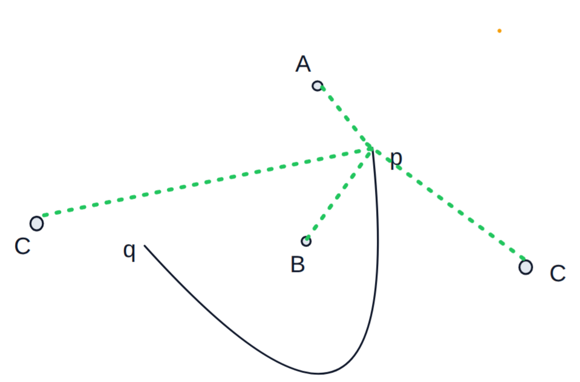
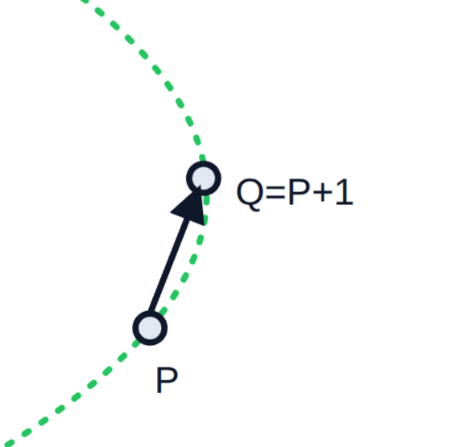
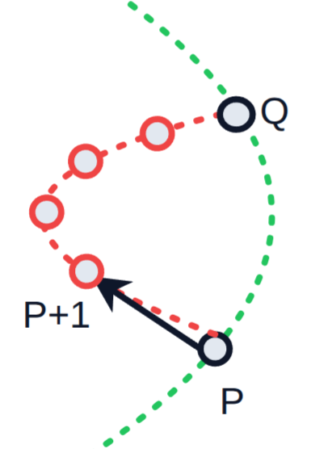

# Melkman Inverse

### Sergey Safronov

### November 2026

# Introduction

In CSE/AMS 345, we are interested in the "inverse" problem of Melkman's linear-time convex-hull finding algorithm. Formally defined, it is:

# Problem Statement

Does a particular ordered collection `A` of arrays of integers, `A_i`, correspond to an output from Melkman’s linear-time convex-hull algorithm on a valid (simple non-crossing) chain?

# Conventions, IO, and terminology

We call the input `melk_out: Integer[][]`, which stands for Melkman output. Each entry in `melk_out` is an array we call `step: Integer[]`. We are taking each `step` to correspond to the output of the Melkman algorithm when the `i+2`th point is considered.

> Note: the algorithm conventionally starts at the first non-trivial chain: either <2,1,0,2> or <2,0,1,2>. Hence, the first entry in `melk_out` corresponds to the 2nd point considered.

As per conventions, I am considering the mainstream implementation of Melkman's algorithm, meaning that each `step` corresponds to the clockwise convex hull when `i+2` points are considered.

Likewise, all indices are 0-based, implying all inputs are taken to be unsigned integers.

We aim to solve the decision problem, meaning the algorithm must return a `boolean` value.

# Invariants

Our approach is to try to analyze what sorts of invariants a valid Melkman output would have, and then checking an instance input against them iteratively.

First, let's constrain an arbitrary array of `Integers` to ones that _"look"_ like possible Melkman outputs.

Since Melkman's algorithm keeps a deque data structure, all of our arrays must be of a _sandwich_ form, leading to the following first invariant, which we will revise later:

> [!Important]
>
> 1. Each array `melk_out[i]` must be of form `[n, ..., n]` for some integer `n`, `i` $\in$ `[0, length(melk_out) + 2]`

Next, we have

> [!IMPORTANT]
>
> 2. `melk_out[i][1:-1]` cannot have duplicates

The proof for this is trivial. If a point `j` is present two or more times in the middle of the sandwich, it implies that it shows up at two or more places on the convex hull, which is impossible. Each point can only be present at at most on place on the boundary of the convex hull.

Lastly,

> [!IMPORTANT]
>
> 3. Given a set `skipped[i]: Set<Integer>`, corresponding to all the nodes that were marked internal before the `i+2`th point was considered, `melk_out[i]` $\bigcap$ `skipped[i]` == `{ }` (empty set)

This is because once a node has been marked as internal in the convex hull, we cannot unwrap the hull in such a way as to make that node a member on the convex hull. Notice that this is not the case for the converse. Nodes that are on the convex hull, can lose their _convexity status_ as we analyze more points along the simple chain. We discuss this in the next section.

## What happens at each step

Now, let's analyze what can happen at a given step `i`.

Assuming that the previous convex hull was valid, the chain can do one of the following 3 things:

**Case A:** The new point can extend the convex hull without updating the relative convexity of previous points
**Case B:** The new point can go inside of a convex pocket, making the node "internal" to the convex hull
**Case C:** Extend the convex hull in a way that removes some nodes from the _new_ convex hull (I'll call this **unwrapping**)

Visually, the cases look like the following:

> Imagine that the convex hull is abstractly represented by the curved line, with `q` < `p`
> Note that case C could unwrap from either side of the convex hull - removing either from the left, or the right in this example. We will prove that these cases are identical, and, can therefore be labeled the same.

Before we start, notice that in every case other than **Case B**, the point will be on the new deque of the convex hull. This leads us to the revision of our first invariant

> [!IMPORTANT]
>
> 4. If `melk_out[i] != melk_out[i-1]`, then `i-2` $\in$ `melk_out[i]`. More specifically, following the _sandwich_ invariant, we know that `melk_out[i]` must be of form `[(i+2), ..., (i+2)]`

Now, let's dive into the cases:

#### Case A

This one is pretty trivial. We know that for a previous arrangement called `prev := melk_out[i-1]`, and a new point `s`, we will have the following form:

> [!IMPORTANT]
>
> **Case A** can only be of the form `[s, melk_out[i-1], s]`

This follows directly from the definition of Case A. We are _preserving_ everything that we had previously, and **adding** the new point to the convex hull.

#### Case B

Case B is our internal case. From the initial look, it's really simple. To be internal, is to be omitted from the convex hull. Meaning, to detect if we are in **Case B**, we just need to check if

> [!IMPORTANT]
>
> **Case B** can be uniquely identified at step `i` if `melk_out_[i] == melk_out[i-1]`.

Can **Case B** always happen? Yes! This is because the convex hull always has a pocket between the first point and the last point. In Melkman notation, this means that

On our diagram above, that is the pocket between points `p` and `q`.

> [!IMPORTANT]
>
> In fact, we can detect a pocket by the fact that on the convex hull, the difference between two _(circularly)_ adjacent vertices is more than 1.

> Proof:
> Given a convex hull of a simple, non-crossing, integer indexed chain, we know that if the difference between two adjacent vertices `p` and `q` (with `p` < `q`) is 1, then the `p` directly is connected to `q`. The term _directly_ connected means that the edge from `p` to `q` on the chain is exactly the edge from `p` to `q` on the convex hull. This follows from the fact that the chain is connected and indexed in a sequential manner.
>
> 
>
> > _Example diagram of direct connection_
>
> Now let's consider what happens if the difference is more than one. Since the point indexed `p+1` is not directly on the convex hull, we know that it is internal to the hull. Hence, there is a **pocket** between that point `p+1`, and the edge of the convex hull from `p` to `q`
> 
>
> > _Example diagram of pocket. P+1 is internal to the convex hull edge `pq`, meaning that it, and all of its successors that are not `q` form a pocket (denoted by the region between the red and green dashed edges). You can have arbitrarily many red vertices after `P+1` and preserve the pocket_

This implies that:

> [!IMPORTANT]
> There is always a pocket between `melk_out[i][1]` and `melk_out[i][-2]` because the difference $ p-q > 1$
